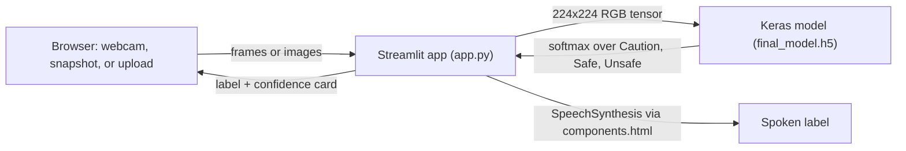

# SIC-AI-Classification: AI-Based Early Hazard Awareness System for Visually Impaired Users

A Streamlit app that labels a camera scene as **Safe**, **Caution**, or **Unsafe** with a fine-tuned MobileNetV2 model, then speaks the result aloud. **SIC Capstone Group 32.**


**Live demo:** [sic-ai.streamlit.app](https://sic-ai.streamlit.app)

## Overview

The goal is to warn visually impaired users about hazards early. A transfer-learned image classifier (MobileNetV2 with ImageNet weights plus a small dense head) sorts scenes into three classes. The app accepts a live webcam stream, a snapshot, or an uploaded image. Each prediction appears in a card and can be spoken through the browser's speech synthesis.

## Features

- **Live Video**: streams the webcam with `streamlit-webrtc` and classifies every frame. The live prediction card updates as you go, and you can record up to 150 frames and download them as a GIF.
- **Camera**: takes a snapshot with `st.camera_input` and classifies it instantly.
- **Upload**: classifies PNG, JPG, JPEG, or BMP images.
- **Audio feedback**: a toggle (on by default) speaks the predicted label. A label is repeated only when it changes.
- **Prediction cards**: show the label and model confidence, with a status chip for whether the model loaded.
- **Preprocessing**: images are converted to RGB, resized to 224 x 224, and scaled to `[0, 1]`.

## How It Works



### Model and Training

All training is in `MobileNetV2_Model.ipynb`:

| Item | Details |
| --- | --- |
| Data | Folder-per-class dataset: 2,250 training and 247 validation images across 3 classes. The dataset is not included in the repo. |
| Architecture | `MobileNetV2(include_top=False, pooling="avg", weights="imagenet")`, then `Dense(128, relu)`, `Dropout(0.3)`, and `Dense(3, softmax)` (2.42M parameters) |
| Phase 1 | Frozen base, Adam `1e-4`, 15 epochs |
| Phase 2 | Last 40 base layers unfrozen, Adam `1e-5`, 15 epochs |
| Recorded result | About 80% validation accuracy on the 247 validation images (per-class F1: Caution 0.84, Safe 0.78, Unsafe 0.77) |
| Export | `final_model.h5` (Keras HDF5). Class order is in `labels.txt`. |

## Tech Stack

- **App:** Streamlit 1.52, streamlit-webrtc (PyAV frames), Pillow, NumPy, imageio (GIF export)
- **Model:** TensorFlow 2.20 / Keras, MobileNetV2 transfer learning, h5py
- **Training notebook:** TensorFlow, scikit-learn, seaborn, matplotlib
- **Hosting:** Streamlit Community Cloud (`runtime.txt` pins Python 3.11)

## Getting Started

**Prerequisites:** Python 3.11.

```bash
git clone https://github.com/4waiz/SIC-AI-Classification.git
cd SIC-AI-Classification
python -m venv .venv
source .venv/bin/activate          # Windows: .venv\Scripts\activate
pip install -r requirements.txt
streamlit run app.py
```

The app opens at <http://localhost:8501>. `final_model.h5` must stay in the project root, because `app.py` loads it at startup.

### Dev Container / Codespaces

`.devcontainer/devcontainer.json` uses the `python:1-3.11-bookworm` image and installs `requirements.txt`. It then starts the app with `streamlit run app.py --server.enableCORS false --server.enableXsrfProtection false` and forwards port 8501.

### Retraining the Model

1. Arrange your data as `train/<class>/` and `val/<class>/` with the classes `Caution`, `Safe`, and `Unsafe`.
2. Install the extra notebook dependencies: `pip install scikit-learn seaborn matplotlib jupyter`.
3. In `MobileNetV2_Model.ipynb`, set `train_dir` and `val_dir` to your folders and run all cells. The last cell saves `final_model.h5`.

## Configuration

No API keys or environment variables are needed. `app.py` sets `TF_ENABLE_ONEDNN_OPTS=0` by default and reads class names from `labels.txt`. If the file is missing, it falls back to `class_<index>`.

## Project Structure

```
SIC-AI-Classification/
├── app.py                    # Streamlit app: live video, camera, upload, audio feedback
├── final_model.h5            # trained Keras model (MobileNetV2 + dense head)
├── labels.txt                # class names: Caution, Safe, Unsafe
├── MobileNetV2_Model.ipynb   # training and evaluation notebook
├── requirements.txt
├── runtime.txt               # python-3.11 (Streamlit Community Cloud)
└── .devcontainer/            # Dev Containers / GitHub Codespaces config
```

## Team

SIC Capstone Group 32:

- **Awaiz Ahmed** ([@4waiz](https://github.com/4waiz)): Streamlit app development and Streamlit Cloud deployment
- **Lamya Faizal Salma** ([@LamyaFS](https://github.com/LamyaFS)): model training notebook
- **Ramidos Mumin**: initial Streamlit app with audio feedback and model

---

Built by [Awaiz Ahmed](https://github.com/4waiz) with Lamya Faizal Salma and Ramidos Mumin
